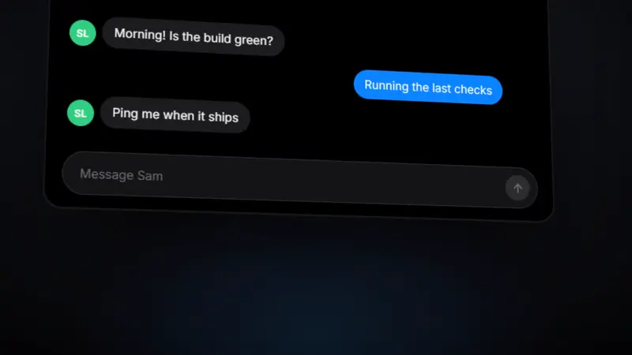
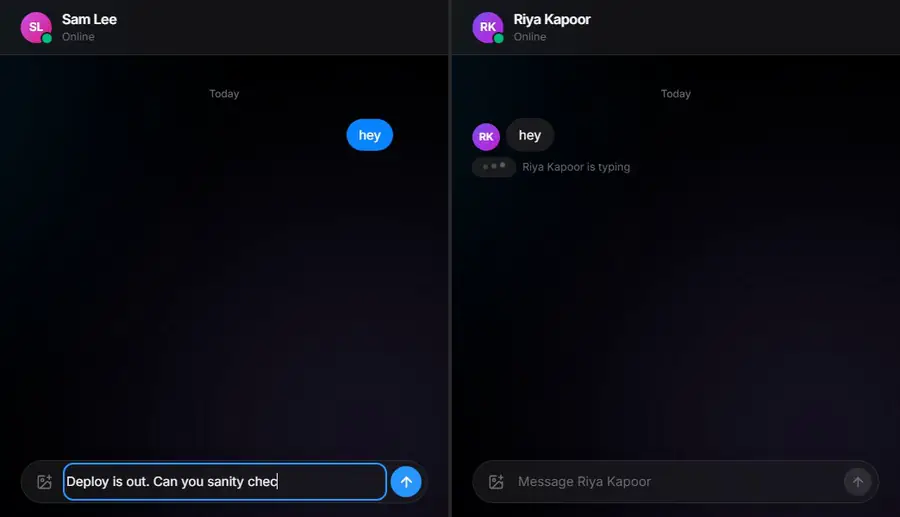
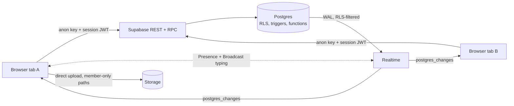

# BuzzBell

[](https://github.com/pradumya004/BuzzBell/actions/workflows/ci.yml)

Realtime chat with no app server. The browser talks straight to Postgres through Supabase, and Row Level Security is the whole authorization layer. The tests try to break it.

**Live:** [buzz-bell-ycsb.vercel.app](https://buzz-bell-ycsb.vercel.app). Click **Try it as a guest**, no signup. Open a private window as a second guest to watch typing, presence and messages arrive live.

[](docs/launch.mp4)

[Watch the 14 s film (MP4)](docs/launch.mp4). Below, a real recording of two guests:



## Features

- Public channels and one-to-one DMs
- Messages, edits, deletes and reactions live in every open tab
- Typing indicators and who's online
- Image attachments, full-text search (Ctrl/⌘ K), unread counts
- BuzzBot, so someone testing alone still gets replies
- Light and dark theme, reduced motion, single-column layout on phones

## What's interesting

**The database is the backend.** There is no API server to secure. Every table has RLS policies, and column-level grants limit clients to editing message text, read markers and their own display name. If a query is allowed, Postgres allowed it.

**Realtime goes through the same rules.** Message changes stream over Supabase Realtime `postgres_changes`, which applies each subscriber's RLS before sending a row. Typing goes over Broadcast and presence over Presence, so neither writes to the database.

**Logic lives in triggers and functions:**
- `open_dm` is race-safe: a DM is keyed by the sorted pair of user ids, so two people opening it at once get the same row.
- `inbox()` returns every room with its last message and unread count in one round trip.
- `search_messages()` uses a generated `tsvector` column with a GIN index and runs as the caller, so it only returns rows they can read.
- A trigger caps each user at 8 messages per 10 seconds, since this is a public demo.
- Soft deletes clear the text in a trigger, so a deleted message never stays in the table.
- BuzzBot is a trigger. It welcomes new users and answers DMs in the same transaction as their message.
- `is_member()` is a small `security definer` function, so policies on `members` can check membership without recursing into themselves.

**Optimistic UI.** A sent message shows up at once, then reconciles with whichever lands first, the insert response or the realtime echo. A failed send shows the reason.

## Architecture



| Layer | File |
|---|---|
| Tables, constraints, indexes | [`001_schema.sql`](supabase/migrations/001_schema.sql) |
| RLS policies, column grants, storage rules, realtime publication | [`002_security.sql`](supabase/migrations/002_security.sql) |
| Signup trigger, `create_channel`, `open_dm`, `inbox`, `search_messages`, rate limit, edit and delete triggers | [`003_functions.sql`](supabase/migrations/003_functions.sql) |
| BuzzBot | [`004_buzzbot.sql`](supabase/migrations/004_buzzbot.sql) |
| Unique guest names | [`005_guest_names.sql`](supabase/migrations/005_guest_names.sql) |
| React app: store, sidebar, room, overlays | [`src/`](src) |

## Tests

| Command | What it checks | Needs |
|---|---|---|
| `npm run test:sql` | 34 checks. Runs every migration and the seed on PGlite (Postgres in WASM) with stand-ins for Supabase auth and storage, then acts as different users: outsiders can't read, search, post into, join or upload to a DM; nobody can post or react as someone else; only authors can edit; protected columns can't change; rate limit, BuzzBot, `open_dm`, `inbox` | nothing, runs offline |
| `npm test` | 5 unit tests for message grouping and time labels, plus 12 RLS tests against a real Supabase project with three signed-in guests | `VITE_SUPABASE_URL`, `VITE_SUPABASE_ANON_KEY` (RLS tests skip without them; `SUPABASE_DB_URL` also deletes the test users afterwards) |

CI runs the type check, both suites and a production build on every push.

## Run locally

1. Create a Supabase project. Under Authentication, enable **Anonymous sign-ins**.
2. `cp .env.example .env.local` and fill in the project URL, anon key and session-pooler connection string.
3. Load the schema. Either run `npm run db -- --seed` (applies the migrations in order, then seeds channels and demo users), or paste [`supabase/setup.sql`](supabase/setup.sql) into the SQL editor (all migrations and the seed in one file, built by `npm run bundle`).
4. Start it:

```bash
npm install
npm run dev
```

## Stack

React 19, TypeScript, Vite, Tailwind CSS 4, Motion, Supabase (Postgres, Auth, Realtime, Storage), Vitest, PGlite. Hosted on Vercel.

The original 2024 version (MERN + Socket.IO) is tagged [`v1-mern`](https://github.com/pradumya004/BuzzBell/tree/v1-mern).
