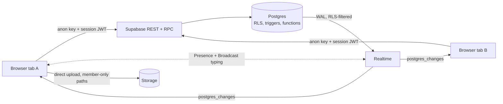

# BuzzBell

Realtime chat on Postgres. Channels, DMs, reactions, image attachments, presence, typing indicators and full-text search, live across every open tab. There is no app server: Postgres Row Level Security is the whole authorization layer, and the tests try to break it.

**Live:** _deploying_ · one click, no signup: **Try it as a guest**, then open a second tab or private window to chat with yourself.

<!-- screenshots: docs/landing.png, docs/app.png -->

## What's in it

- **Channels and DMs.** Public channels anyone can join, DMs that exist once per pair (a sorted-pair unique key makes `open_dm` race-safe).
- **Live everything.** Messages, edits, deletes and reactions stream over Supabase Realtime `postgres_changes`, filtered per subscriber by the same RLS policies. Typing goes over Broadcast and who's online over Presence, so neither touches the database.
- **Optimistic UI.** Messages appear instantly, reconcile with the server row (or the realtime echo, whichever lands first), and show a reason if they fail.
- **One-query sidebar.** `inbox()` returns every room with its last message and unread count in a single round trip.
- **Search.** A generated `tsvector` column with a GIN index; `search_messages()` runs as the caller, so it only ever returns rows they can read.
- **BuzzBot.** A Postgres trigger that welcomes new people and answers DMs in the same transaction as their message, so someone testing alone still gets a conversation.
- **Abuse limits for a public demo.** A trigger caps each user at 8 messages per 10 seconds; column-level grants stop clients from editing anything but message text, read markers and their own display name.

## How it's built



| Layer | Where |
|---|---|
| Tables, constraints, indexes | [`001_schema.sql`](supabase/migrations/001_schema.sql) |
| RLS policies, column grants, storage rules, realtime publication | [`002_security.sql`](supabase/migrations/002_security.sql) |
| Signup trigger, `create_channel`, `open_dm`, `inbox`, `search_messages`, rate limit, edit/delete triggers | [`003_functions.sql`](supabase/migrations/003_functions.sql) |
| BuzzBot | [`004_buzzbot.sql`](supabase/migrations/004_buzzbot.sql) |
| React app | [`src/`](src) (store, room, sidebar, overlays) |

Design choices worth calling out:
- `is_member()` is a tiny `security definer` function so policies on `members` can check membership without recursing into themselves.
- Soft deletes clear the content in a trigger, so a deleted message never leaves its text in the table.
- The UI follows the system theme, respects `prefers-reduced-motion`, and collapses to a single column on phones.

## Tests

```bash
npm test
```

- `tests/format.test.ts`: message grouping and time labels (offline).
- `tests/rls.test.ts`: signs in three real guests against the project and checks that outsiders can't read, search, post into, join or upload to someone else's DM, that nobody can post as someone else or edit another person's message, that protected columns can't be changed, that BuzzBot answers, and that floods are rate-limited. Test users are deleted afterwards. Skipped without `.env.local`.

## Run it

1. Create a Supabase project. In Authentication, enable **Anonymous sign-ins**.
2. `cp .env.example .env.local` and fill in the URL, anon key and the session-pooler connection string.
3. Then:

```bash
npm install
npm run db -- --seed   # applies supabase/migrations in order, then seeds channels and demo users
npm run dev
```

## Stack

React 19, TypeScript, Vite, Tailwind CSS 4, Motion, Supabase (Postgres, Auth, Realtime, Storage), Vitest.

The original 2024 version (MERN + Socket.IO) is tagged [`v1-mern`](https://github.com/pradumya004/BuzzBell/tree/v1-mern).
